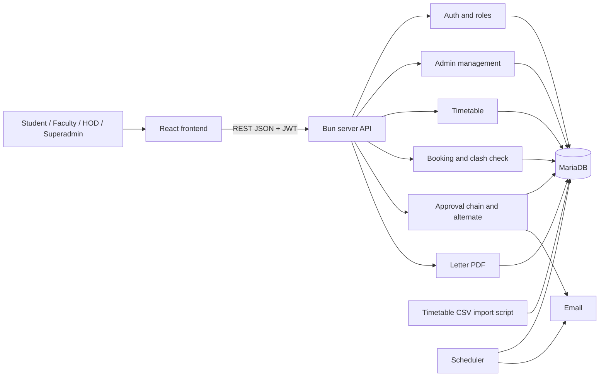
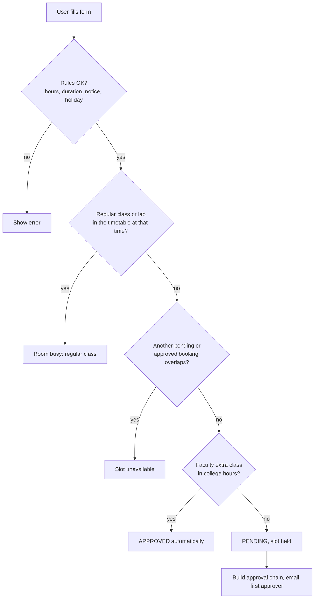
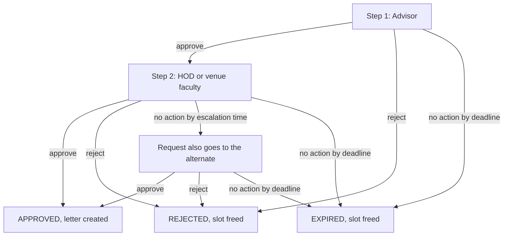
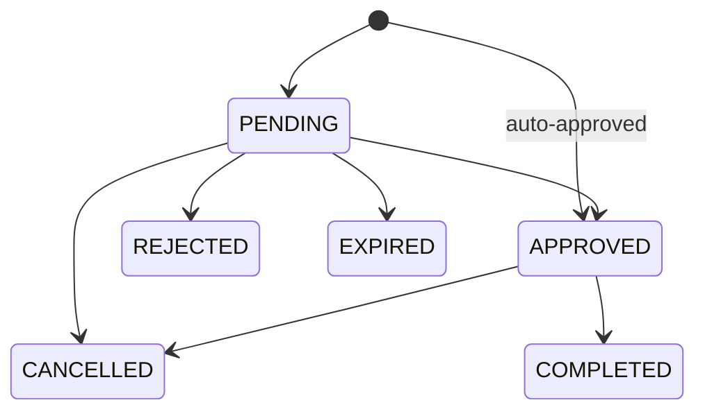

# Venue Booking System

Complete Project Document (A to Z). Round 2 task, deadline 23 Oct. Draft, pending mentor review. Updated version: regular timetable added, HOD alternate changed to time-based escalation.

## What changed in this version

- **Timetable added.** Regular classes and labs are stored in a new `timetable_slots` table. The clash check now looks at the timetable as well as bookings, so a room is never offered during a regular lecture.
- **HOD alternate changed.** An alternate is no longer chosen by date range. Each HOD has a fixed alternate. If the HOD does not act within a set time, the request also goes to the alternate, who can then approve.
- **Scheduler changed.** It now escalates to the alternate, then expires the request at the final deadline. The separate reminder is replaced by the escalation email.
- **Tables changed.** New: `timetable_slots`. Changed: `alternates` (no dates), `approvals` (`escalate_at` and `escalated_at` replace `reminded_at`).

## 1. Problem and goal

The task: build a platform that simplifies booking college venues (classrooms, seminar halls, auditoriums) with availability checking and reservation management.

Our solution replaces paper letters and physical signatures with an in-system approval chain. A request is checked against the rules and the regular timetable, sent to the right approvers in the right order, and an approval letter is generated automatically at the end.

**The main problem we solve:** approvers such as the HOD are busy. So the system picks approvers automatically, sends the request to a fixed alternate if the HOD does not respond in time, auto-approves routine bookings, and expires forgotten requests so a venue is never blocked forever.

## 2. Roles

| Role | Who |
|---|---|
| Student | Any student, including club secretaries |
| Faculty | Any teacher, including club advisors, lab faculty, venue faculty and AC in-charge |
| HOD | Head of a department |
| Superadmin | Runs the whole system, including all admin duties |

Club advisor, lab faculty, venue faculty, AC in-charge and HOD alternate are **assignments stored in the database**, not extra roles. Access control checks only the four roles. The approval chain checks the assignments.

## 3. Booking rules

- College hours: **8:30 to 18:30, Monday to Saturday**. Sunday, holidays and anything outside hours count as after-hours.
- Maximum **4 hours** per booking, and a booking must start and end on the same date.
- Notice window: classroom or lab, apply at least **2 hours** ahead and at most **14 days** ahead. Seminar hall and auditoriums, at least **3 days** and at most **30 days** ahead.
- Blocked dates (exam, maintenance) cannot be booked. A period with the reason "holiday" counts as after-hours.
- A booking may not overlap another **pending or approved** booking for the same venue.
- A booking may not overlap a **regular timetable class or lab** for the same venue on that weekday, within the semester dates of that slot.
- All numbers above live in the `settings` table and can be changed without code changes.
- Seminar hall and auditoriums can be requested through a club, or by faculty.

## 4. Features

| No. | Feature | Details |
|---|---|---|
| 1 | Login | Email and password, logout, change password. Accounts created by superadmin or seed script |
| 2 | Roles and access | Four roles, checked on every action |
| 3 | Superadmin panel | Manage users, departments, clubs, venues, holidays, settings, alternates and timetable. Cancel any booking with a mandatory reason. View audit log |
| 4 | Departments | Add and edit departments, each with an HOD |
| 5 | Venues | Classroom, lab, seminar hall, mini auditorium, main auditorium. Owner is a department or the Academic Complex. One approver faculty per venue |
| 6 | Clubs | One faculty advisor per club. The student picks the club and the advisor is filled in automatically |
| 7 | Timetable | Regular classes and labs stored per room, weekday and time. Imported from the existing timetables through a CSV file. Shown on the calendar as blocked time |
| 8 | Booking | Availability calendar. Form with venue, date, time, title, purpose, people, and reason (club, or other with advisor). Cancel own booking, history and status |
| 9 | Clash detection | No overlap with pending or approved bookings, and none with the regular timetable. Checked in a MariaDB transaction with a row lock |
| 10 | Automatic approval chain | Built by the system from venue and requester. Order enforced |
| 11 | HOD alternate | Each HOD has a fixed alternate. If the HOD does not act in time, the request goes to the alternate too, and either can approve |
| 12 | Scheduler | Escalate to the alternate, auto-expire and free the slot, mark finished bookings COMPLETED |
| 13 | Email notifications | Request received, approved, rejected, escalated, expired, cancelled |
| 14 | Approval letter | Created after the final approval, showing the HOD approval. Letter number, view and PDF download. No QR and no verification page |
| 15 | Dashboards | Student: my bookings. Faculty and HOD: requests waiting for me. Superadmin: all bookings and summary |
| 16 | Audit log | Who did what and when, for every state change |
| 17 | Database schema | MariaDB, final version in section 8 |

### Booking states

PENDING, APPROVED, REJECTED, EXPIRED, CANCELLED, COMPLETED

## 5. Approval rules

| Booking | Requester | Step 1 | Step 2 |
|---|---|---|---|
| Faculty extra class, in college hours, room free | Faculty | None | None, auto-approved |
| Classroom in a department, club event | Student via club | Club advisor (filled automatically) | HOD of the room's department |
| Classroom in a department, other reason | Student | Chosen faculty advisor | HOD of the room's department |
| Classroom in the Academic Complex | Student or club | Advisor | Venue approver faculty |
| Lab | Student or faculty | Lab faculty (venue approver) | None |
| Seminar hall, mini or main auditorium | Club or faculty | Advisor | Venue approver faculty |

- The HOD is always the HOD of the **room's department**, not the requester's. A CSE student booking an ENTC room needs the ENTC HOD.
- Step 2 can never be approved before step 1. The HOD never acts before the advisor.
- If a person would approve their own request, that step is skipped.
- The system chooses approvers. The user never types an approver, except the advisor for the "other" reason.

### HOD alternate (time-based escalation)

- Each HOD has **one fixed alternate**, a senior faculty member. The superadmin sets it once in the `alternates` table.
- A request first goes only to the HOD.
- If the HOD has not acted by the **escalation time**, the request is **also sent to the alternate**. Both get an email, and the pending list of the alternate now shows it.
- From then on **either** the HOD or the alternate can approve or reject. Whoever acts first decides.
- The record stores who really acted (`acted_by`) and for whom (`on_behalf_of`). The letter then says "approved by X on behalf of HOD Y".
- Before escalation, the alternate cannot act. This keeps the HOD in charge when they are available.
- The same mechanism works for any approver that has an alternate set. For now the plan is to set alternates for HODs only.

### Deadlines

- Each step gets a total time **D**: **48 hours, or half the time left before the event if that is shorter**.
- **Escalation** happens at half of D. For example, D = 48 hours means the alternate gets the request after 24 hours.
- **Expiry** happens at D. If nobody acted, the request expires and the slot is freed.
- The clock of step 2 starts only after step 1 is approved.
- An expired requester can apply again.

## 6. Architecture

A **modular monolith**: one backend with a separate module for each area, one database and one scheduler job. It is simple enough for a four-person team with little time, and each module can be split out later.



*Figure 1: System components*

| Module | What it does | Main tables |
|---|---|---|
| Auth and roles | Login with JWT, bcrypt passwords, role check on every route | users |
| Admin management | Users, departments, clubs, venues, holidays, settings, alternates, cancel any booking | departments, clubs, venues, blackout_periods, settings, alternates |
| Timetable | Stores regular classes and labs, lists them for the calendar, imports from CSV | timetable_slots |
| Booking | Calendar, booking rules, clash check against bookings and timetable, cancel own booking | bookings, timetable_slots |
| Approval chain | Builds the steps, enforces order, approve or reject, lets the alternate act after escalation | approvals, alternates |
| Letter | Creates the approval letter and PDF | letters |
| Notifications | Emails for every important event | none |
| Scheduler | Escalation, expiry, mark COMPLETED | approvals, bookings |
| Audit | Records every state change | audit_log |

## 7. Flows

### 7.1 Booking request



*Figure 2: Booking request flow*

There is no waiting queue in this version. A pending request holds the slot. If it is rejected, cancelled or expired, the slot is free and anyone can apply.

### 7.2 Approval with alternate



*Figure 3: Approval flow with escalation*

### 7.3 Booking states



*Figure 4: Booking states*

### 7.4 Cancel

- The requester can cancel their own pending or approved booking.
- The superadmin can cancel any booking but **must give a reason**. The requester is notified.
- A cancelled booking frees the slot immediately.

### 7.5 Letter

- Created automatically after the last approval.
- Shows college name, letter number, requester, club, venue, date, time, and each approver with the time of approval, ending with the HOD (or the alternate on behalf of the HOD).
- Available to view and download as PDF. Marked as system-generated, no signature needed.
- There is no QR code and no public verification page in this version.

### 7.6 Scheduler

Runs every few minutes:

- **Escalate:** pending approvals whose `escalate_at` has passed and `escalated_at` is empty. Set `escalated_at`, then email the HOD (as a reminder) and the alternate.
- **Expire:** pending approvals whose `due_at` has passed. Mark the approval and the booking EXPIRED, free the slot, email the requester.
- **Complete:** approved bookings whose end time has passed become COMPLETED.

```sql
SELECT a.id
FROM approvals a JOIN bookings b ON b.id = a.booking_id
WHERE a.decision = 'pending' AND b.status = 'pending'
  AND a.escalated_at IS NULL AND a.escalate_at <= NOW();
```

### 7.7 Timetable import

- Put every timetable into one CSV, one row per class period.
- Columns: venue, day, start, end, type, class_name, subject, faculty_email, valid_from, valid_to.
- The venue name must match a venue in the database exactly, and the faculty email must match a user. Rows that do not match are listed as errors and skipped.
- An import script reads the CSV and inserts the rows into `timetable_slots`. Check the row counts and a few rooms against the paper timetable afterwards.
- For a new semester, add new rows with new `valid_from` and `valid_to`. Old rows stay.

```
venue,day,start,end,type,class_name,subject,faculty_email,valid_from,valid_to
CSE-101,Mon,09:30,10:30,lecture,SE CSE A,Data Structures,rao@college.edu,2026-08-01,2026-11-30
CSE-Lab1,Tue,14:00,17:00,lab,TE CSE A B1,DBMS Lab,lab@college.edu,2026-08-01,2026-11-30
```

## 8. Database schema (MariaDB)

| Table | Purpose |
|---|---|
| departments | Departments and their HOD |
| users | All users, with one of four roles |
| clubs | Clubs and their single faculty advisor |
| venues | Venues, owner (department or complex) and the approver faculty |
| bookings | Booking requests and their status |
| approvals | One row per approval step, with escalation and final deadline |
| alternates | One fixed alternate per approver (for example per HOD) |
| letters | Approval letter record |
| blackout_periods | Holidays and blocked dates |
| timetable_slots | Regular weekly classes and labs per room |
| settings | Hours, maximum duration, deadlines, notice rules |
| audit_log | Who did what and when |

**Rules the code must follow:**

- **Clash check:** inside one transaction, lock the venue row with `SELECT ... FOR UPDATE`, then check (a) an overlapping booking with status pending or approved and (b) an overlapping timetable slot. Insert only if both are clear. MariaDB has no overlap constraint, so this is required.
- **Who may act on a step:** the assigned approver at any time, or the approver's alternate only after `escalated_at` is set. Record `acted_by` and `on_behalf_of`.
- **Deadlines:** when a step becomes active, set `escalate_at` = now + D/2 and `due_at` = now + D, where D = the smaller of 48 hours and half the time left before the event. Step 2 gets its times only after step 1 is approved.
- **Extra class:** no approval rows are created and the status is `approved` immediately, but only if the timetable and bookings are clear.
- **Create the tables in the given order.** `departments` is created first and `hod_id` is linked after `users` exists.
- Needs MariaDB 10.2.1 or newer for `CHECK` constraints.

Timetable check inside the clash transaction (the booking date and times are the parameters):

```sql
SELECT 1 FROM timetable_slots
WHERE venue_id = ?
  AND day_of_week = WEEKDAY(?) + 1          -- booking date
  AND ? BETWEEN valid_from AND valid_to     -- booking date
  AND start_time < ?                        -- booking end time
  AND end_time   > ?                        -- booking start time
LIMIT 1;
```

Full SQL:

```sql
CREATE DATABASE IF NOT EXISTS venue_booking
  CHARACTER SET utf8mb4 COLLATE utf8mb4_unicode_ci;
USE venue_booking;

CREATE TABLE departments (
  id      INT UNSIGNED AUTO_INCREMENT PRIMARY KEY,
  name    VARCHAR(100) NOT NULL UNIQUE,
  hod_id  INT UNSIGNED NULL
);

CREATE TABLE users (
  id             INT UNSIGNED AUTO_INCREMENT PRIMARY KEY,
  name           VARCHAR(120) NOT NULL,
  email          VARCHAR(150) NOT NULL UNIQUE,
  password_hash  VARCHAR(255) NOT NULL,
  role           ENUM('student','faculty','hod','superadmin') NOT NULL DEFAULT 'student',
  department_id  INT UNSIGNED NULL,
  is_active      BOOLEAN NOT NULL DEFAULT TRUE,
  created_at     TIMESTAMP DEFAULT CURRENT_TIMESTAMP,
  FOREIGN KEY (department_id) REFERENCES departments(id)
);

ALTER TABLE departments ADD FOREIGN KEY (hod_id) REFERENCES users(id);

CREATE TABLE clubs (
  id             INT UNSIGNED AUTO_INCREMENT PRIMARY KEY,
  name           VARCHAR(120) NOT NULL UNIQUE,
  advisor_id     INT UNSIGNED NOT NULL,
  department_id  INT UNSIGNED NULL,
  FOREIGN KEY (advisor_id) REFERENCES users(id),
  FOREIGN KEY (department_id) REFERENCES departments(id)
);

CREATE TABLE venues (
  id             INT UNSIGNED AUTO_INCREMENT PRIMARY KEY,
  name           VARCHAR(120) NOT NULL UNIQUE,
  type           ENUM('classroom','lab','seminar_hall','mini_auditorium','main_auditorium') NOT NULL,
  building       VARCHAR(100),
  floor          VARCHAR(20),
  capacity       INT UNSIGNED NOT NULL,
  owner_type     ENUM('DEPARTMENT','COMPLEX') NOT NULL DEFAULT 'DEPARTMENT',
  department_id  INT UNSIGNED NULL,
  approver_id    INT UNSIGNED NULL,
  is_active      BOOLEAN NOT NULL DEFAULT TRUE,
  FOREIGN KEY (department_id) REFERENCES departments(id),
  FOREIGN KEY (approver_id) REFERENCES users(id)
);

CREATE TABLE bookings (
  id               BIGINT UNSIGNED AUTO_INCREMENT PRIMARY KEY,
  venue_id         INT UNSIGNED NOT NULL,
  requester_id     INT UNSIGNED NOT NULL,
  booking_type     ENUM('extra_class','club_event','other') NOT NULL DEFAULT 'other',
  club_id          INT UNSIGNED NULL,
  advisor_id       INT UNSIGNED NULL,
  title            VARCHAR(200) NOT NULL,
  purpose          TEXT,
  expected_people  INT UNSIGNED,
  start_time       DATETIME NOT NULL,
  end_time         DATETIME NOT NULL,
  status           ENUM('pending','approved','rejected','expired','cancelled','completed')
                   NOT NULL DEFAULT 'pending',
  cancel_reason    VARCHAR(300) NULL,
  cancelled_by     INT UNSIGNED NULL,
  created_at       TIMESTAMP DEFAULT CURRENT_TIMESTAMP,
  updated_at       TIMESTAMP DEFAULT CURRENT_TIMESTAMP ON UPDATE CURRENT_TIMESTAMP,
  FOREIGN KEY (venue_id) REFERENCES venues(id),
  FOREIGN KEY (requester_id) REFERENCES users(id),
  FOREIGN KEY (club_id) REFERENCES clubs(id),
  FOREIGN KEY (advisor_id) REFERENCES users(id),
  FOREIGN KEY (cancelled_by) REFERENCES users(id),
  CHECK (end_time > start_time),
  INDEX idx_venue_time (venue_id, start_time, end_time),
  INDEX idx_requester (requester_id),
  INDEX idx_status (status)
);

CREATE TABLE approvals (
  id            BIGINT UNSIGNED AUTO_INCREMENT PRIMARY KEY,
  booking_id    BIGINT UNSIGNED NOT NULL,
  step_order    TINYINT UNSIGNED NOT NULL DEFAULT 1,
  approver_id   INT UNSIGNED NOT NULL,
  decision      ENUM('pending','approved','rejected','expired') NOT NULL DEFAULT 'pending',
  acted_by      INT UNSIGNED NULL,
  on_behalf_of  INT UNSIGNED NULL,
  remarks       VARCHAR(500),
  escalate_at   DATETIME NULL,                         -- when the alternate gets the request
  escalated_at  DATETIME NULL,                         -- set when it was actually escalated
  due_at        DATETIME NULL,                         -- final deadline, then EXPIRED
  decided_at    DATETIME NULL,
  FOREIGN KEY (booking_id) REFERENCES bookings(id) ON DELETE CASCADE,
  FOREIGN KEY (approver_id) REFERENCES users(id),
  FOREIGN KEY (acted_by) REFERENCES users(id),
  FOREIGN KEY (on_behalf_of) REFERENCES users(id),
  UNIQUE (booking_id, step_order),
  INDEX idx_approver_pending (approver_id, decision),
  INDEX idx_due (decision, due_at)
);

CREATE TABLE alternates (
  user_id       INT UNSIGNED PRIMARY KEY,    -- the approver (for example an HOD)
  alternate_id  INT UNSIGNED NOT NULL,       -- gets the request if the approver does not act in time
  FOREIGN KEY (user_id) REFERENCES users(id),
  FOREIGN KEY (alternate_id) REFERENCES users(id),
  CHECK (user_id <> alternate_id)
);

CREATE TABLE letters (
  id            BIGINT UNSIGNED AUTO_INCREMENT PRIMARY KEY,
  booking_id    BIGINT UNSIGNED NOT NULL UNIQUE,
  letter_no     VARCHAR(40) NOT NULL UNIQUE,
  issued_by     INT UNSIGNED NOT NULL,
  on_behalf_of  INT UNSIGNED NULL,
  created_at    TIMESTAMP DEFAULT CURRENT_TIMESTAMP,
  FOREIGN KEY (booking_id) REFERENCES bookings(id),
  FOREIGN KEY (issued_by) REFERENCES users(id),
  FOREIGN KEY (on_behalf_of) REFERENCES users(id)
);

-- reason = 'holiday' makes the period count as after-hours; any other reason blocks booking.
CREATE TABLE blackout_periods (
  id          INT UNSIGNED AUTO_INCREMENT PRIMARY KEY,
  venue_id    INT UNSIGNED NULL,
  start_time  DATETIME NOT NULL,
  end_time    DATETIME NOT NULL,
  reason      VARCHAR(200),
  FOREIGN KEY (venue_id) REFERENCES venues(id) ON DELETE CASCADE,
  CHECK (end_time > start_time)
);

-- Regular timetable (weekly repeating classes and labs)
CREATE TABLE timetable_slots (
  id           INT UNSIGNED AUTO_INCREMENT PRIMARY KEY,
  venue_id     INT UNSIGNED NOT NULL,
  day_of_week  TINYINT UNSIGNED NOT NULL,        -- 1 = Mon ... 6 = Sat
  start_time   TIME NOT NULL,
  end_time     TIME NOT NULL,
  slot_type    ENUM('lecture','lab') NOT NULL DEFAULT 'lecture',
  class_name   VARCHAR(60) NOT NULL,             -- e.g. 'SE CSE A'
  subject      VARCHAR(120) NULL,
  faculty_id   INT UNSIGNED NULL,
  valid_from   DATE NOT NULL,                    -- semester start
  valid_to     DATE NOT NULL,                    -- semester end
  FOREIGN KEY (venue_id) REFERENCES venues(id) ON DELETE CASCADE,
  FOREIGN KEY (faculty_id) REFERENCES users(id),
  CHECK (day_of_week BETWEEN 1 AND 6),
  CHECK (end_time > start_time),
  CHECK (valid_to >= valid_from),
  INDEX idx_tt_lookup (venue_id, day_of_week, start_time, end_time)
);

CREATE TABLE settings (
  name   VARCHAR(50) PRIMARY KEY,
  value  VARCHAR(100) NOT NULL
);

INSERT INTO settings (name, value) VALUES
  ('day_start', '08:30'),
  ('day_end', '18:30'),
  ('max_booking_hours', '4'),
  ('approval_deadline_hours', '48'),
  ('classroom_min_notice_hours', '2'),
  ('classroom_max_advance_days', '14'),
  ('hall_min_notice_days', '3'),
  ('hall_max_advance_days', '30');

CREATE TABLE audit_log (
  id          BIGINT UNSIGNED AUTO_INCREMENT PRIMARY KEY,
  booking_id  BIGINT UNSIGNED NULL,
  actor_id    INT UNSIGNED NULL,
  action      VARCHAR(50) NOT NULL,
  details     TEXT NULL,
  created_at  TIMESTAMP DEFAULT CURRENT_TIMESTAMP,
  FOREIGN KEY (actor_id) REFERENCES users(id),
  INDEX idx_booking (booking_id)
);
```

## 9. API routes (plan)

These are the planned routes. Agree on exact request and response shapes in the group before connecting pages.

| Area | Routes |
|---|---|
| Auth | POST /auth/login, GET /me, POST /auth/change-password |
| Venues and clubs | GET /venues, GET /venues/:id/availability?date= (returns bookings and timetable blocks), GET /clubs |
| Booking | POST /bookings, GET /bookings/mine, GET /bookings/:id, POST /bookings/:id/cancel |
| Approval | GET /approvals/pending (includes escalated requests for the alternate), POST /approvals/:id/approve, POST /approvals/:id/reject |
| Letter | GET /bookings/:id/letter (PDF) |
| Superadmin | CRUD for /admin/users, /admin/departments, /admin/clubs, /admin/venues, /admin/blackouts, /admin/settings, /admin/alternates, /admin/timetable. POST /admin/timetable/import (CSV). GET /admin/bookings, GET /admin/audit |

## 10. Frontend (React) and work split

Four members. Each works only in their own pages and folder to avoid merge conflicts.

| Member | Pages and work |
|---|---|
| Member 1 | Project setup, login, logout, change password. Navbar and menu by role. Common parts (buttons, forms, tables, popups, status badges). Dashboards for each role. Audit log page. **Do the setup first, everyone depends on it.** |
| Member 2 | Superadmin management pages: users, departments (assign HOD), clubs (assign advisor), venues (type, capacity, owner, approver), holidays and blocked dates, settings, **HOD alternates**, **timetable (list, add, edit, delete, CSV upload)**. |
| Member 3 | Booking pages: availability calendar that shows **regular classes as grey blocked time** and bookings as coloured blocks, booking form (club reason fills the advisor automatically, other reason needs an advisor and a reason), clear error messages including "regular class at that time", my bookings with cancel, booking details with approval progress. |
| Member 4 | Approval pages: pending list that shows why it came to me (as advisor, as HOD, or **escalated from HOD**), approve or reject with remark, letter view and PDF download, all bookings for superadmin with cancel and mandatory reason. |

| Pages | Who can open |
|---|---|
| Login | Everyone |
| Dashboard, calendar, booking pages | All roles |
| Approvals | Faculty and HOD |
| Admin pages, all bookings, audit log, alternates, timetable | Superadmin only |

### Frontend folder structure

```
frontend/src/
  features/auth/ and dashboards     Member 1
  features/admin/                   Member 2
  features/booking/                 Member 3
  features/approvals/ and letters/  Member 4
  components/                       shared pieces
  api/client.js                     fetch helper that adds the token
```

### Backend folder structure

```
backend/
  src/
    index.js          server start
    config.js         reads .env
    db.js             MariaDB connection and transactions
    auth.js           login, token check, role check
    routes/           one file per module
    services/         booking, approval, timetable, letter, notify
    jobs/scheduler.js
  db/schema.sql, seed.sql, import_timetable.js
  .env.example
```

## 11. Tech stack

| Layer | Choice |
|---|---|
| Frontend | React (Vite) and React Router |
| Backend | Bun server, mysql2 driver, JWT, bcrypt, Nodemailer, pdfkit |
| Database | MariaDB |
| Config | .env and .env.example, no secrets in the repository |

**Test early on Bun:** pdfkit and the scheduler. If one fails, use a simple `setInterval` job or another PDF library.

## 12. Working rules (from the task)

- Use git. Never commit directly to main. Use feature branches and pull requests, reviewed by at least one teammate.
- Commit messages in present tense, format `<type>: <description>`, for example `feat: add booking form`.
- Keep commits small. Merge to main often. Pull the latest changes before starting work.
- No secrets, build files, logs or empty files in the repository. Keep `.gitignore` and `.env.example`.
- Keep the README updated. Write clear documentation.
- No emojis in code. Use meaningful names and avoid repeated code.
- Test each part while building. Every member must be able to explain their own part.
- Use steering files (.md) to give context to the AI tool, and read AI code before committing it.

## 13. Timeline (deadline Fri 23 Oct)

| Dates | Work |
|---|---|
| Sun 18 to Mon 19 | Set up the repo, load the schema and test users, agree on API shapes. Member 1 pushes setup and login. Others build pages with fake data. Start extracting the timetable into the CSV |
| Tue 20 to Wed 21 | Build the modules, connect real API calls, import the timetable |
| Thu 22 | Test the full flow as each role. Fix bugs. README and diagrams |
| Fri 23 | Buffer and submission only, no new features |

## 14. Test cases to check

- Two people book the same slot at the same time: only one succeeds.
- A booking over a regular class in the timetable is refused, but the same time on another weekday is allowed.
- A booking after the semester end date of a timetable slot is not blocked by that slot.
- Faculty extra class in hours is approved automatically only if the room is free. After hours it needs approval.
- The HOD cannot approve before the advisor.
- Booking an ENTC room from CSE goes to the ENTC HOD.
- Before the escalation time, the alternate cannot approve. After it, both the HOD and the alternate can.
- When the alternate approves, the record and the letter show "on behalf of HOD".
- If nobody acts by the deadline, the request expires and the slot is free again.
- A rejected request frees the slot.
- A booking outside the notice window, over 4 hours, or on a blocked date is refused.
- Superadmin cancel without a reason is refused.
- A student cannot open admin pages.
- The letter is created only after the last approval.

## 15. Not in this version (future scope)

- Waiting queue, monthly recurring booking, CR role, club members list
- A regular class cancelled for one day (needs a timetable exceptions table)
- QR code and public letter verification
- One-tap email approval links, bulk approve
- Admin edit and reassign of bookings
- WhatsApp and SMS, Google Calendar sync

## 16. Open questions for the mentor

- Is the HOD also in the chain for the seminar hall and auditoriums? This document assumes **no**.
- Who is the approver faculty for the seminar hall, the mini auditorium, the main auditorium and the Academic Complex?
- Who is the alternate of each HOD? Is escalating at half of the deadline (24 hours of 48) acceptable, or should it be a fixed time?
- Is a 48 hour approval deadline acceptable?
- Is the system-generated letter accepted in place of a signed paper letter, or does security need a printout?
- Is the scope for 23 Oct acceptable?
